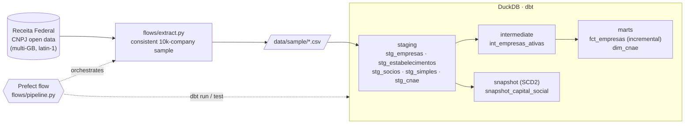

# cnpj-dbt-pipeline

[](https://github.com/lucasnardivieira/cnpj-dbt-pipeline/actions/workflows/ci.yml)

A local analytics pipeline over Brazil's public **CNPJ company registry** (Receita Federal open data). It samples the multi-GB raw files into a consistent subset, models them in layers with **dbt + DuckDB**, enforces data-quality tests, keeps **SCD Type 2** history with dbt snapshots, and orchestrates the whole run with **Prefect**.

## Architecture



| Layer | Models | Materialization | What it does |
|---|---|---|---|
| staging | `stg_empresas`, `stg_estabelecimentos`, `stg_socios`, `stg_simples`, `stg_cnae` | view | Trims, nulls empty strings, normalizes CNPJ and registration status (macros), parses `capital_social` (`1000,00` → `1000.00`) |
| intermediate | `int_empresas_ativas` | view | Joins companies × establishments, filters by status, keeps **one row per company** (head office first) |
| marts | `fct_empresas` | incremental (`unique_key = cnpj_basico`) | Company fact table; incremental on `data_situacao_cadastral` to simulate daily loads |
| marts | `dim_cnae` | table | CNAE 2.0 hierarchy (division / group / class / subclass) with company counts |
| snapshots | `snapshot_capital_social` | snapshot (`check` on `capital_social`) | SCD Type 2 history of share capital |

Reusable macros: `limpar_cnpj`, `padronizar_situacao_cadastral`, `gerar_coluna_auditoria`.

## Quickstart (synthetic data, ~1 minute)

You need [uv](https://docs.astral.sh/uv/). Python 3.11–3.12 is installed by uv if missing.

```bash
git clone https://github.com/lucasnardivieira/cnpj-dbt-pipeline.git
cd cnpj-dbt-pipeline
uv sync

# load the synthetic fixtures as the sample sources
mkdir -p data/sample && cp tests/fixtures/*.csv data/sample/

uv run dbt deps
uv run dbt build        # run + test + snapshot, in DAG order
uv run python ver_dados.py
```

`profiles.yml` is committed and points to `data/cnpj.duckdb`. Override it with `DUCKDB_PATH=/some/path.duckdb`.

## Running on the real Receita Federal data

1. Download the CNPJ open data ("Dados Abertos do CNPJ") from Receita Federal. Only **part 0** of each partitioned file is needed. Unzip into `downloaded_files/` keeping the original names (about 15 GB of free disk):

   | File in `downloaded_files/` | Content |
   |---|---|
   | `K3241.K03200Y0.D60711.EMPRECSV` | Companies (part 0) |
   | `K3241.K03200Y0.D60711.ESTABELE` | Establishments (part 0) |
   | `K3241.K03200Y0.D60711.SOCIOCSV` | Partners (part 0) |
   | `F.K03200$W.SIMPLES.CSV.D60711` | Simples Nacional tax regime (single file) |
   | `F.K03200$Z.D60711.CNAECSV` | CNAE reference table |

2. Build the sample and run the pipeline, either step by step:

   ```bash
   uv run python flows/extract.py   # writes data/sample/*.csv
   uv run dbt deps
   uv run dbt build
   ```

   or through Prefect (extract → `dbt run` → `dbt test`, 1 retry per task):

   ```bash
   uv run python flows/pipeline.py
   ```

### How the sample stays consistent
The raw files are not aligned by `cnpj_basico`, so taking the first N rows of each file produces samples that never join. `extract.py` does the following:
1. Reads only the `cnpj_basico` column of companies and establishments, in 500k-row chunks.
2. Intersects the two sets.
3. Draws 10,000 keys from the intersection with a fixed seed.
4. Filters every file by that same key set.

## Data quality

`dbt build` runs **11 tests**:
- 10 generic tests in [`models/schema.yml`](models/schema.yml): `not_null`, `unique`, `accepted_values`, `relationships` (`stg_socios` → `stg_empresas`), and `dbt_utils.expression_is_true` (capital and company counts never negative).
- 1 singular test, [`tests/assert_fct_empresas_not_empty.sql`](tests/assert_fct_empresas_not_empty.sql). An empty mart passes every column test, so this test fails the build when `fct_empresas` comes out empty.

### SCD Type 2 evidence

The sample is static, so a source change was simulated by editing `capital_social` for one company between two `dbt snapshot` runs:

| cnpj_basico | capital_social | dbt_valid_from | dbt_valid_to |
|---|---|---|---|
| 41277443 | 0.0 | 2026-08-04 20:06:46 | 2026-08-04 20:07:25 |
| 41277443 | 99000.0 | 2026-08-04 20:07:25 | null |

The old row is closed and a new current row is opened, which shows the `check` strategy captured the change.

## CI

GitHub Actions ([`.github/workflows/ci.yml`](.github/workflows/ci.yml)) runs on every push and PR:
- **lint**: `ruff check`, `ruff format --check`, and `sqlfluff lint` (dbt templater, DuckDB dialect)
- **dbt-build**: loads the synthetic fixtures from [`tests/fixtures/`](tests/fixtures/), then runs `dbt build` and a second build to exercise the incremental path

The fixtures are a handful of rows per source, built to hit the interesting cases:
- a company with a head office and a branch
- a closed company that gets filtered out
- partners that must join to companies
- a public entity with no share capital

## Lessons learned

The first version ran `dbt run` and `dbt test` without a single error, and every mart was **empty**. Two independent bugs caused it:

1. **Samples without overlap.** Each raw file was sampled independently. The files aren't sorted by `cnpj_basico`, so the `inner join` returned 0 rows. The fix was the intersection-based sampling described above.
2. **Filter compared against the wrong domain.** `int_empresas_ativas` filtered `situacao_cadastral` with raw codes (`'01'`, `'02'`…). By that point a staging macro had already mapped those codes to labels (`'Ativa'`…), so the filter never matched.

Fixing the overlap exposed a third issue: companies with several branches multiplied rows in the join and broke `unique` on `fct_empresas`. A `qualify row_number()` that prefers the head office fixed it.

Takeaway: *no SQL error ≠ correct data*. Volume checks such as the non-empty test belong next to the column tests.

## Project layout

```
flows/            extract.py (sampling) · pipeline.py (Prefect flow)
models/           staging/ · intermediate/ · marts/ · _sources.yml · schema.yml
macros/           reusable Jinja macros
snapshots/        SCD2 snapshot of capital_social
tests/            singular tests · fixtures/ (synthetic CI data)
ver_dados.py      quick look at the DuckDB tables
```

## Cost

Everything runs locally on DuckDB. There are no cloud resources, so nothing needs to be torn down: delete `data/` to reset.
